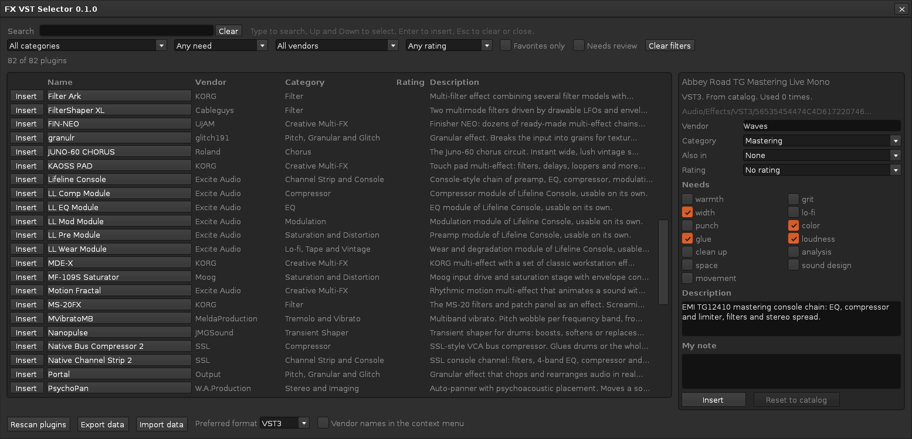
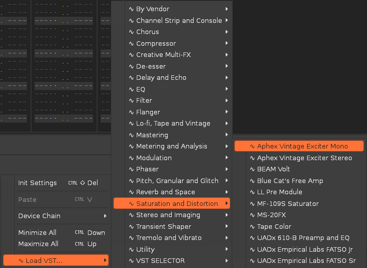

# FX VST Selector

A Renoise tool that helps you pick the right effect plugin when you add one to a
DSP chain. Renoise's own "Add Favorites" menu only lists plugin names. This tool
adds a **Load VST...** submenu that sorts your effect plugins by category and by
vendor, and a **browser window** where you can search them, filter them by what
you need (warmth, width, punch, space...) and read a short description of what
each one does.



*The browser window: search, filters, result list, and the detail panel used to edit a plugin.*



*The Load VST... submenu, next to Renoise's own DSP chain menu entries.*

## Features

- **Load VST... context menu** in the DSP chain and DSP device right-click
  menus: one submenu per category (Compressor, EQ, Reverb and Space, Tape...),
  plus By Vendor. It sits next to the native "Add Favorites" menu, which the
  Renoise API does not allow to replace.
- **Show Vendor Names**: an option to display plugins as "Vendor - Plugin" in
  the menu.
- **Browser window** with a search that filters while you type (names,
  vendors, descriptions, notes and tags), and filters by category, need,
  vendor, rating, Renoise favorites and "Needs review".
- **Catalog** of short, factual descriptions for about 580 common effect
  plugins. Plugins it does not know land in "Uncategorized".
- **Editor**: change the category, needs, vendor and description of any
  plugin, add your own note and a rating from 1 to 5 stars. Your edits always
  win over the catalog, and "Reset to catalog" brings the original back.
- **Insertion** right after the selected device, or at the end of the chain,
  on any track type. Ctrl + Z undoes it.
- **Usage counter** per plugin, shown in the browser.
- **Export and import** of your data (edits, notes, ratings, counters).
- VST and VST3 builds of the same plugin are merged into one entry. VST3 is
  preferred by default; the format can be changed in the browser.

## Requirements

- Renoise 3.5 (scripting API 6.2). Tested on Windows only. The tool contains
  no platform-specific code, but has not been tried on macOS or Linux.
- Effect plugins in VST or VST3 format, scanned by Renoise.

## Download

1. Open the [Releases](../../releases) page of this repository.
2. Download `renoise-fx-vst-selector-<version>.xrnx` from the latest release.
3. Optional: check the file against the `.sha256` file published next to it.
   In PowerShell:

   ```powershell
   Get-FileHash .\renoise-fx-vst-selector-v1.0.0.xrnx -Algorithm SHA256
   ```

   The printed hash must match the one in the `.sha256` file (letter case
   does not matter).

## Installation

Drag the `.xrnx` file onto the Renoise window, or double-click it. Renoise
installs the tool and asks no further question. To update, install the newer
`.xrnx` the same way: your data is kept (see [Your data](#your-data)).

## Usage

### Context menu

Right-click an empty area of a track's DSP chain (or a device in it) and open
**Load VST...**:

- a category, then a plugin, inserts it;
- **By Vendor** lists the plugins of each vendor;
- **Open Browser...** opens the browser window;
- **Rescan Plugins** reads the plugin list again. Renoise does not tell tools
  when it rescans its plugins, so use this after a plugin rescan in Renoise's
  preferences. The list is also refreshed when a song is loaded;
- **Show Vendor Names** switches the labels to "Vendor - Plugin". A check mark
  shows when it is on.

A plugin rated in the browser shows its stars in the menu, for example
`Blackhole  ****`.

### Browser window

Open it from the context menu, from **Tools > FX VST Selector > Open
Browser...**, or with a key binding (see below).

- Type anywhere in the window to search. All words must match.
- **Up** and **Down** move the selection, **Page Up** and **Page Down** move by
  a page, **Enter** inserts the selected plugin, **Esc** clears the search and
  then closes the window.
- The filters on the second line narrow the list by category, need, vendor,
  minimum rating, Renoise favorites, and entries marked "Needs review".
- **Insert** on a row inserts that plugin; clicking its name selects it.

### Editing a plugin

Select a plugin in the list. The panel on the right shows its details and
edits them:

- vendor, category, "Also in" (a second category), rating;
- needs, as check boxes;
- description (120 characters at most) and your own note.

Changes are saved at once. **Reset to catalog** drops your edits of the
catalog fields; your note and rating are kept. Entries marked "Needs review"
are cautious guesses: correct them, and they stop being marked.

### Key binding

In Renoise's preferences, **Keys** tab, search for "Selector" and assign a key to
**Open FX VST Selector Browser**. Two bindings exist: one in the Global
section, one that only works while the DSP chain has the keyboard focus.

## Your data

Your edits, notes, ratings, usage counters and settings are stored in a single
file, outside the tool folder, so that updating the tool or Renoise keeps them:

| System  | Location |
| ------- | -------- |
| Windows | `%APPDATA%\Renoise\com.glitch191.RenoiseFxVstSelecta\userdata.json` |
| macOS   | `~/Library/Preferences/Renoise/com.glitch191.RenoiseFxVstSelecta/userdata.json` (not tested) |
| Linux   | `~/.config/Renoise/com.glitch191.RenoiseFxVstSelecta/userdata.json` (not tested) |

If that folder cannot be created, the file is written inside the tool folder
instead. If the file is damaged, the tool renames it to
`userdata.corrupt-<date>.json`, shows a warning and starts again from the
catalog.

To back up or move your data, use **Export Data...** and **Import Data...** in
the browser or in **Tools > FX VST Selector**. Importing replaces your current
data, after a confirmation.

## Changing the catalog and the categories

- `tool/data/taxonomy.lua`: the list of categories and needs. Names must not
  contain ":". The list is flat on purpose; sub-categories are supported but
  not used.
- `tool/data/catalog.lua` and `tool/data/catalog_vendors.lua`: one entry per
  plugin, with its names, vendor, category, optional second category, needs
  and description.

Catalog names are matched after normalization: letter case, channel layout
("Stereo", "(Mono)"), format markers and a trailing version (one or two digits, "v2" or "2.5") are ignored, so
"Blue Cat's Chorus 4 (Stereo)" matches the entry "Blue Cat's Chorus". Run the
tests after any change: they check that every category and need used by the
catalog exists, that no name is listed twice and that no description is longer
than 120 characters.

### Contributing descriptions

Descriptions say what a plugin does and when to reach for it, in plain words,
120 characters at most, without marketing language. If you are not sure about
a plugin, add `needs_review = true` to its entry. Pull requests that add or
correct entries are welcome.

## Development

### Project structure

```text
tool/                    The tool itself; its content is the .xrnx file
  manifest.xml           Tool id, version and API version
  main.lua               Menus, key bindings, notifications, actions
  browser.lua            Browser window and editor
  devices.lua            Device list and insertion (Renoise API)
  storage.lua            User data file, export and import
  core/                  Pure Lua logic, no Renoise API (tested)
    names.lua            Name normalization, vendor and format detection
    grouping.lua         Merges VST and VST3 builds into plugin entries
    merge.lua            Combines plugins, catalog and user data
    search.lua           Search and filters
    menu_layout.lua      Context menu entries
    json.lua             JSON encoder and decoder
  data/
    taxonomy.lua         Categories and needs
    catalog.lua          Plugin descriptions (first entries)
    catalog_vendors.lua  More plugin descriptions, grouped by vendor
tests/
  run.lua                Unit tests of the pure logic and of the catalog
  smoke.lua              Runs main.lua and browser.lua against a fake Renoise API
scripts/
  build-xrnx.ps1         Builds dist/<project>-<tag>.xrnx and its checksum
  install-dev.ps1        Copies tool/ into Renoise's tools folder
docs/
  manual-checklist.md    Checks to do by hand in Renoise
  screenshots/           Images used in this README
.github/workflows/
  release.yml            Builds and attaches the .xrnx to each release
```

### Running the tests

The tests need a standalone Lua 5.1 compatible interpreter, such as
[LuaJIT](https://luajit.org/) or Lua 5.1. From the repository root:

```bash
luajit tests/run.lua
```

```bash
luajit tests/smoke.lua
```

All plugin names used by the tests are made up, except in the checks of the
shipped catalog. The smoke test imitates the Renoise API: it catches Lua
errors but does not prove that the tool works in Renoise. The checks to do by
hand are listed in [docs/manual-checklist.md](docs/manual-checklist.md).

### Trying a change in Renoise

```powershell
./scripts/install-dev.ps1
```

Then use **Tools > Reload All Tools** in Renoise. The script writes only the
folder of this tool in Renoise's tools folder. Add `-RenoiseVersion V3.5.4` to
target a specific Renoise version folder.

### Building the .xrnx

```powershell
./scripts/build-xrnx.ps1 -Tag v1.0.0
```

This writes `dist/renoise-fx-vst-selector-v1.0.0.xrnx` and its `.sha256` file.
The version from the tag is written into the packaged `manifest.xml` only; the
repository is not modified. Without `-Tag`, the file is named `...-dev.xrnx`.

### Releases

Publishing a release on GitHub runs `.github/workflows/release.yml` on
Windows: it runs the tests, builds the `.xrnx` with the release tag as its
version, and attaches the `.xrnx` and its `.sha256` file to the release. The
workflow can also be started by hand from the Actions tab ("Run workflow"); the
files are then available as a workflow artifact named `xrnx`.

## License

[MIT](LICENSE), copyright 2026 glitch191.

Plugin and vendor names belong to their respective owners and are used only to
identify the plugins. Catalog descriptions are indicative and may be
inaccurate; you can correct them in the browser.
